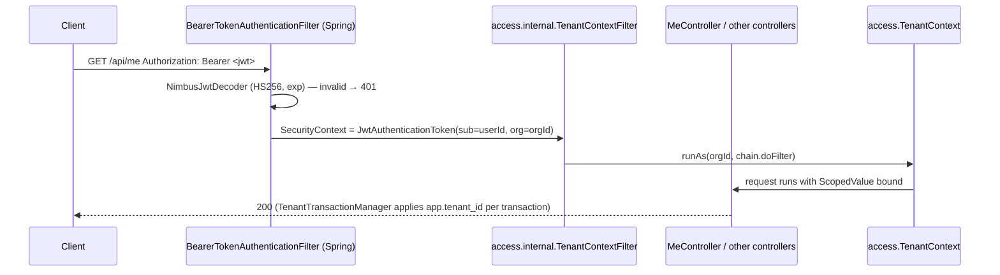
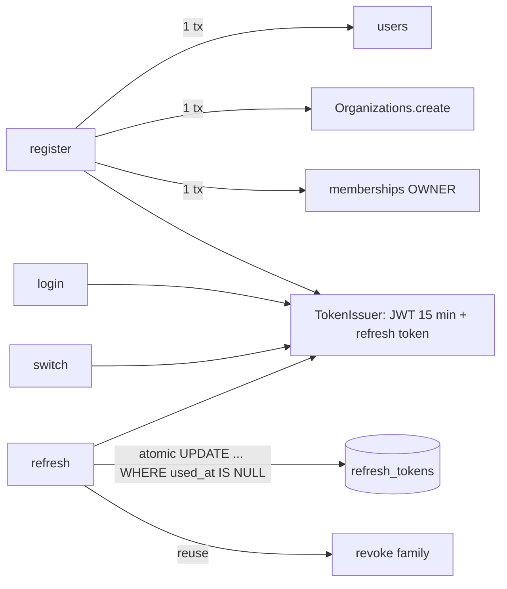

# Authentication Design

**Spec**: `.specs/features/12-authentication/spec.md`
**Status**: Approved

Abordagem: Spring Security como resource server JWT (HMAC) + emissão própria de tokens, tudo dentro do módulo `access` (AD-002). Descartado: filtro JWT escrito à mão (reimplementa validação de assinatura/expiração que o `spring-boot-starter-security-oauth2-resource-server` já faz) e sessão HTTP (recusada no spec, 2a).

---

## Architecture Overview





- Endpoints públicos: `/api/auth/register|login|refresh|logout`, `/actuator/health`. Todo o resto exige JWT válido.
- `TenantContextFilter` roda depois do filtro de bearer; sem autenticação JWT ele só passa adiante (os públicos rodam sem tenant).
- O tenant vem só do claim `org` do JWT (AUTH-04); nada lê organização de header/param/body, exceto o `organizationId` pedido no switch, que é validado contra memberships antes de virar token.

---

## Code Reuse Analysis

| Component | Location | How to Use |
| --------- | -------- | ---------- |
| `TenantContext.runAs` | `access/TenantContext.java` | Chamado pelo filtro por requisição |
| `Organizations.create` | `access/Organizations.java` | Cadastro chama dentro da mesma transação; valida nome/slug e lança `InvalidSlugException`/`DuplicateSlugException`/`InvalidNameException` |
| `TenantTransactionManager` | `access/internal/` | Inalterado: aplica o tenant em toda transação |
| Padrão de unicidade via `DataIntegrityViolationException` + nome da constraint | `Organizations.create` | Mesmo padrão para `users_email_key` (cadastro concorrente → 409) |
| `TestcontainersConfiguration`, padrão `owner()` do `DatabaseRolesIT` | `src/test/...` | Novos `*IT`; inspecionar hashes como `atlas_owner` |
| `Companies` | `company/Companies.java` | Prova de isolamento via HTTP: teste cria empresa dentro do tenant do token |

### Integration Points

| System | Integration Method |
| ------ | ------------------ |
| Maven | + `spring-boot-starter-security-oauth2-resource-server`, `spring-boot-starter-validation`, `org.bouncycastle:bcprov-jdk18on` (exigido pelo `Argon2PasswordEncoder`), `spring-boot-starter-security-test` (test) |
| PostgreSQL | V5: `users`, `memberships`, `refresh_tokens` (globais, sem RLS — ADR-002) |
| Config | `atlas.security.jwt-secret` (`${ATLAS_JWT_SECRET}`, sem default; ≥ 32 bytes); TTLs fixos no código |

---

## Components

Tudo em `access`. Só o que outros módulos podem precisar fica público.

### access.CurrentUser (API pública)
- **Purpose**: ler o usuário autenticado da requisição atual.
- **Interfaces**: `static UUID id()` — do `SecurityContext`; lança se não autenticado.
- Fica público para os módulos futuros; o tenant continua em `TenantContext`.

### access.internal.SecurityConfiguration
- **Purpose**: `SecurityFilterChain` stateless, CSRF off (sem cookies), públicos acima, `oauth2ResourceServer().jwt()`, `TenantContextFilter` após `BearerTokenAuthenticationFilter`; entry point 401 em `ProblemDetail`.
- **Beans**: `JwtDecoder` (`NimbusJwtDecoder.withSecretKey(HS256)`), `JwtEncoder` (`NimbusJwtEncoder(new ImmutableSecret<>(key))`), `PasswordEncoder` = `Argon2PasswordEncoder.defaultsForSpringSecurity_v5_8()` (Argon2id).
- **Reuses**: auto-config do resource server só para o filtro.

### access.internal.TenantContextFilter
- **Purpose**: `OncePerRequestFilter`; se a autenticação é `JwtAuthenticationToken`, `TenantContext.runAs(UUID.fromString(jwt.getClaim("org")), () -> chain.doFilter(...))`, relançando `IOException`/`ServletException`.

### access.internal.TokenIssuer
- **Purpose**: emitir o par de tokens.
- **Interfaces**: `TokenPair issue(UUID userId, UUID orgId, UUID familyId)` — JWT `sub`=userId, `org`=orgId, `exp`=+15 min; refresh = 32 bytes `SecureRandom` em base64url, guardado como SHA-256 com `expires_at`=+30 dias.
- `familyId` novo no login/cadastro; mantido no refresh e no switch.

### access.internal.AuthService
- **Purpose**: regras do fluxo; uma transação por operação.
- **Interfaces**:
  - `TokenPair register(name, email, password, orgName, orgSlug)` — normaliza e valida e-mail/senha, insere user, `organizations.create`, membership `OWNER`.
  - `TokenPair login(email, password)` — usuário inexistente também executa `passwordEncoder.matches` contra um hash fixo (tempo parecido); falha → `BadCredentialsException` (401 genérico). Org ativa = membership mais antiga (`created_at, id`).
  - `TokenPair refresh(String token)` — `update refresh_tokens set used_at = now() where token_hash = ? and used_at is null and revoked_at is null and expires_at > now() returning ...`; 0 linhas: se o hash existe com `used_at` → revoga a família (em transação própria, `REQUIRES_NEW`, para sobreviver ao 401) → 401; senão 401. Depois confere membership na org do token → senão 401.
  - `TokenPair switchOrganization(userId, familyId?, orgId)` — sem membership → 403; emite par novo (família nova, pois o access token não carrega família).
  - `void logout(String token)` — `update ... set revoked_at = now() where token_hash = ?`; sempre ok.
- **Reuses**: `Organizations`.

### access.internal.AuthController / MeController
- `POST /api/auth/register` (201), `/login` (200), `/refresh` (200), `/logout` (204), `/switch-organization` (200, autenticado); `GET /api/me`.
- DTOs `record` com `@Valid` (`@NotBlank`, `@Email`, `@Size`); resposta `{accessToken, refreshToken, tokenType:"Bearer", expiresIn:900}`.

### access.internal.AuthExceptionHandler
- `@RestControllerAdvice` → `ProblemDetail`: validação/`InvalidName|InvalidSlug|InvalidPassword|InvalidEmail` 400; `DuplicateEmail|DuplicateSlug` 409; `BadCredentials`/`InvalidRefreshToken` 401; `NotAMember` 403.

---

## Data Models (V5, sem RLS — globais)

```sql
users (id uuid pk, name varchar(120) not null, email varchar(254) not null constraint users_email_key unique,
       password_hash varchar(255) not null, created_at timestamptz not null)
memberships (id uuid pk, user_id uuid not null fk users, organization_id uuid not null fk organizations,
       role varchar(16) not null check (role in ('OWNER','ADMIN','MEMBER')), created_at timestamptz not null,
       unique (user_id, organization_id))
refresh_tokens (id uuid pk, token_hash bytea not null unique, family_id uuid not null, user_id uuid not null fk users,
       organization_id uuid not null fk organizations, expires_at timestamptz not null,
       used_at timestamptz, revoked_at timestamptz)  -- index on family_id
```

- Entidades JPA `User`, `Membership` em `access.internal`; `refresh_tokens` via `JdbcClient`/query nativa (o UPDATE atômico é a razão).
- `atlas_app`: DML padrão da V1; `users.email` imutável (`revoke update` + `grant update (name, password_hash)`), sem delete em `users` (mesma razão das organizações).

---

## Error Handling Strategy

| Error Scenario | Handling | User Impact |
| -------------- | -------- | ----------- |
| Cadastro com e-mail/slug duplicado (inclusive concorrente) | Constraint → exceção de domínio; transação inteira volta | 409, nada criado |
| Senha/e-mail/nome inválidos | Bean Validation + validação no serviço | 400 |
| Credenciais erradas | Mesmo 401 nos dois casos | 401 genérico |
| JWT ausente/inválido/expirado | Entry point do resource server | 401 `ProblemDetail` |
| Refresh reutilizado | Família revogada em `REQUIRES_NEW` | 401; sessão encerrada |
| Switch sem membership | `NotAMemberException` | 403 |

---

## Risks & Concerns

| Concern | Location | Impact | Mitigation |
| ------- | -------- | ------ | ---------- |
| Argon2 exige Bouncy Castle (dependência nova) e é custoso em CPU/memória | `SecurityConfiguration` | Login/cadastro mais lentos; testes mais lentos | Aceito pelo usuário ("vamos usar o Argon2id"); parâmetros padrão do Spring 5.8; hash fixo do login também em Argon2id |
| `ScopedValue` não atravessa threads | `TenantContextFilter` | Async em controller perderia o tenant | Nenhum endpoint async; documentado no filtro |
| Segredo JWT ausente em dev | `application.yaml` | App não sobe | `compose`/README com valor de dev fictício; testes com chave fixa em `src/test/resources` |
| Enumeração de e-mail por tempo de resposta no login | `AuthService.login` | Vazamento leve | Hash fixo comparado quando usuário não existe |
| Cadastro revela e-mail existente (409) | `register` | Enumeração | Aceito: spec AUTH-02 pede 409; rate limit fora de escopo |
| Filtro global em `access` atende endpoints de outros módulos | `SecurityConfiguration` | Acoplamento de toda a web a `access` | Aceito: autenticação é responsabilidade de `access` (ADR-002) |

---

## Tech Decisions

| Decision | Choice | Rationale |
| -------- | ------ | --------- |
| Hash de senha | Argon2id (`Argon2PasswordEncoder`) + Bouncy Castle | Escolha do usuário: "vamos usar o Argon2id" |
| Refresh token | Opaco, SHA-256 no banco, UPDATE condicional | Concorrência resolvida pelo banco (AUTH-07) sem lock explícito |
| Switch | Emite família nova | Access token não carrega família; refresh antigo segue válido até logout/expirar |
| Refresh tokens via SQL, não JPA | `JdbcClient` | UPDATE ... RETURNING atômico |
