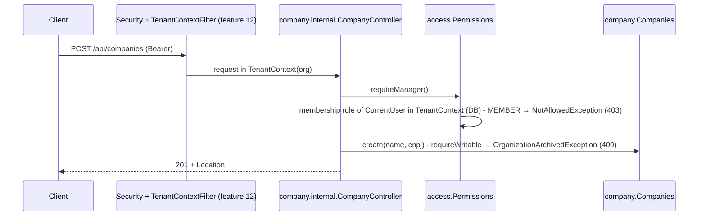

# Companies API Design

**Spec**: `.specs/features/14-companies-api/spec.md`
**Status**: Approved

## Architecture Overview

- The role check happens in the controller, before the domain call: the domain stays role-agnostic and `Companies` is unchanged except for `find`.
- Role comes from the database each request (spec assumption), so a demotion applies to the next request.

## Code Reuse

| Component | How |
| --------- | --- |
| `Companies.create/list/archive/unarchive` | Called as is |
| `MembershipRepository.findByUserIdAndOrganizationId` | Behind `Permissions` |
| `CurrentUser.id()`, `TenantContext.require()` | Inside `Permissions` |
| `AuthExceptionHandler` pattern (`ResponseEntityExceptionHandler`, `assignableTypes`) | `CompanyExceptionHandler` |
| `AuthenticatedRequestIT` helpers (register/login over HTTP), `owner()` JDBC pattern | New `CompanyApiIT`; roles seeded as `atlas_owner` |

## Components

### access.Permissions (public, new)
- `@Service`; `void requireManager()` - `OWNER`/`ADMIN` pass; `MEMBER` or no membership → `access.NotAllowedException`.
- Public because every future module enforces the same rule. `Role` stays internal.

### access.NotAllowedException (public, new)
- Mapped to `403` by each module's handler.

### company.Companies.find(UUID) (new method)
- Returns `CompanyView`, archived or not; `CompanyNotFoundException` when the tenant filter/RLS hides it or it does not exist.

### company.internal.CompanyController (new)
- Endpoints of the spec; `@PathVariable UUID id` (a malformed id maps to `404` in the handler via `MethodArgumentTypeMismatchException`).
- Request `record CreateCompany(@NotBlank String name, String cnpj)`; response = `CompanyView`.

### company.internal.CompanyExceptionHandler (new)
- `InvalidNameException`, `InvalidCnpjException` → 400; `DuplicateCompanyNameException`, `DuplicateCnpjException`, `OrganizationArchivedException` → 409; `CompanyNotFoundException`, type mismatch on id → 404; `NotAllowedException` → 403.

## Error Handling Strategy

| Scenario | Handling | User sees |
| -------- | -------- | --------- |
| MEMBER writes | `Permissions` before domain call | 403, nothing changed |
| Other tenant's id | Tenant filter + RLS hide the row | 404 |
| Archived organization writes | `Organizations.requireWritable` | 409 |
| Duplicate name/CNPJ (also concurrent) | Unique constraint → domain exception | 409 |

## Risks & Concerns

| Concern | Location | Impact | Mitigation |
| ------- | -------- | ------ | ---------- |
| Role check per write is one extra query | `Permissions` | Negligible latency | Accepted; correctness over a token claim (spec assumption) |
| A future controller forgets `requireManager()` | controllers | Silent privilege gap | Each write endpoint has a 403 test; method-security annotations can come when there are more modules |
| `company` now depends on `access.Permissions` | module graph | None new (`company` already uses `access`) | `ModularityTest` |

## Tech Decisions

| Decision | Choice | Rationale |
| -------- | ------ | --------- |
| Where the role rule runs | Controller calls `access.Permissions` | Domain services stay usable from jobs/events without a user |
| 403 mechanism | Own exception, not `@PreAuthorize` | No method security config yet; one explicit call is simpler |
