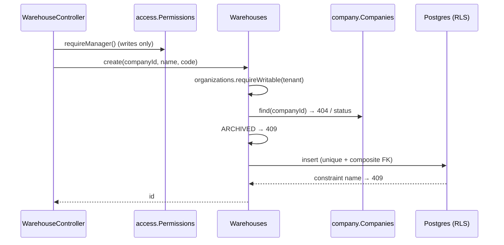

# Warehouses Design

**Spec**: `.specs/features/16-warehouses/spec.md`
**Status**: Approved

---

## Architecture Overview

New Spring Modulith module `warehouse`, a copy of the `company` layout: public service `Warehouses` + view + exceptions at the module root, entity, repository and HTTP in `internal`. It reaches companies only through `company.Companies.find` (public API) and roles through `access.Permissions` (AD-002, ADR-001). Tenant comes from `TenantContext` via `TenantTransactionManager` (AD-001).



---

## Code Reuse Analysis

### Existing Components to Leverage

| Component | Location | How to Use |
| --------- | -------- | ---------- |
| `Companies` (service shape, `find`) | `company/Companies.java` | Same create/list/find/archive structure; `find` for company existence and status |
| `Company` entity | `company/internal/Company.java` | Same `@TenantId`, `archivedAt`, archive/unarchive |
| `CompanyController` / `CompanyExceptionHandler` | `company/internal/` | Same endpoints shape, `ProblemDetail` mapping, malformed id → 404 |
| `Permissions.requireManager()` | `access/Permissions.java` | Writes |
| `Organizations.requireWritable` | `access/Organizations.java` | Archived organization → `409` |
| `V3__companies.sql` | `db/migration/` | RLS policy text, unique-key naming |
| `CompanyApiIT` helpers (`register`, `joinAs`, `owner()`) | `test/.../company/CompanyApiIT.java` | Copied into `WarehouseApiIT` |
| `TenantIsolationIT.everyTenantTableHasForcedRls` | `test/.../TenantIsolationIT.java` | Covers `warehouses` automatically |

### Integration Points

| System | Integration Method |
| ------ | ------------------ |
| `company` module | `Companies.find(UUID)` → `CompanyView.status`; `CompanyNotFoundException` mapped to `404` by the warehouse handler |
| Database | `V6__warehouses.sql`: new table; `companies` gains `unique (tenant_id, id)` as FK target |

---

## Components

### `Warehouses` (public service)

- **Purpose**: Warehouses of a company of the tenant's organization.
- **Location**: `backend/src/main/java/io/github/abreulucass/atlas/warehouse/Warehouses.java`
- **Interfaces**:
  - `UUID create(UUID companyId, String name, String code)` - validates, checks organization writable and company active, saves; maps constraint names to duplicate exceptions
  - `List<WarehouseView> list(UUID companyId, boolean includeArchived)` - `Companies.find` first (404), then by name
  - `WarehouseView find(UUID companyId, UUID id)` - `findByIdAndCompanyId`, else `WarehouseNotFoundException`
  - `void archive(UUID companyId, UUID id)` / `void unarchive(UUID companyId, UUID id)` - organization writable, company must exist, warehouse must belong to it
- **Dependencies**: `WarehouseRepository`, `Companies`, `Organizations`
- **Reuses**: `Companies` structure

### `Warehouse` + `WarehouseRepository` + `WarehouseCode`

- **Location**: `warehouse/internal/`
- `Warehouse(UUID companyId, String name, String code)`; `companyId`, `code` not updatable.
- Repository: `findByCompanyIdOrderByNameAsc`, `findByCompanyIdAndArchivedAtIsNullOrderByNameAsc`, `findByIdAndCompanyId`.
- `WarehouseCode.parse(String)`: strip, upper-case (`Locale.ROOT`), match `[A-Z0-9-]{1,20}`, else `InvalidCodeException`.

### `WarehouseController` + `WarehouseExceptionHandler`

- **Location**: `warehouse/internal/`, `@RequestMapping("/api/companies/{companyId}/warehouses")`
- 400: `InvalidNameException`, `InvalidCodeException`; 403: `NotAllowedException`; 404: `CompanyNotFoundException`, `WarehouseNotFoundException`, `MethodArgumentTypeMismatchException`; 409: `DuplicateWarehouseNameException`, `DuplicateWarehouseCodeException`, `CompanyArchivedException`, `OrganizationArchivedException`.

---

## Data Models

```sql
-- V6__warehouses.sql
alter table companies add constraint companies_tenant_id_key unique (tenant_id, id);

create table warehouses (
    id          uuid primary key,
    tenant_id   uuid not null references organizations (id),
    company_id  uuid not null,
    name        varchar(120) not null,
    code        varchar(20) not null,
    archived_at timestamptz,
    -- the company must belong to the warehouse's own tenant
    constraint warehouses_company_fk foreign key (tenant_id, company_id) references companies (tenant_id, id),
    constraint warehouses_tenant_company_code_key unique (tenant_id, company_id, code)
);
create unique index warehouses_tenant_company_name_key on warehouses (tenant_id, company_id, lower(name));
-- + enable/force RLS and tenant_isolation policy, same text as companies
```

`WarehouseView(UUID id, UUID companyId, String name, String code, Status status)`; `warehouse.Status` `ACTIVE`/`ARCHIVED` (own enum, same as `company.Status`).

---

## Error Handling Strategy

| Error Scenario | Handling | User Impact |
| -------------- | -------- | ----------- |
| Blank/long name, bad code | `InvalidNameException` / `InvalidCodeException` | `400` |
| Duplicate name / code in company | Unique index name in the cause → duplicate exception | `409` |
| Company archived (create) | `CompanyArchivedException` | `409` |
| Organization archived (writes) | `OrganizationArchivedException` from `requireWritable` | `409` |
| Company/warehouse unknown, other tenant, other company, malformed | not-found exceptions / type mismatch | `404` |
| `MEMBER` writes | `NotAllowedException` | `403` |

---

## Risks & Concerns

| Concern | Location | Impact | Mitigation |
| ------- | -------- | ------ | ---------- |
| A company archived between the status check and the insert still gets the warehouse | `Warehouses.create` | One warehouse in a just-archived company | Accepted: archived companies keep warehouses anyway (Archive 7); `shortcut:` comment in code |
| `Status` enum duplicated in `company` and `warehouse` | both modules | Two identical enums | Accepted: sharing it would couple modules for two constants |
| Test helpers duplicated between `CompanyApiIT` and `WarehouseApiIT` | test code | Copy drift | Accepted for now; extract when a third API test needs them |

---

## Tech Decisions

| Decision | Choice | Rationale |
| -------- | ------ | --------- |
| Cross-tenant company reference | Composite FK `(tenant_id, company_id)` → `companies (tenant_id, id)` | FK checks bypass RLS; a plain FK on `company_id` would accept another tenant's company |
| Company existence for list/archive | `Companies.find` before the warehouse query | Spec requires `404` for an unknown company even when listing |
