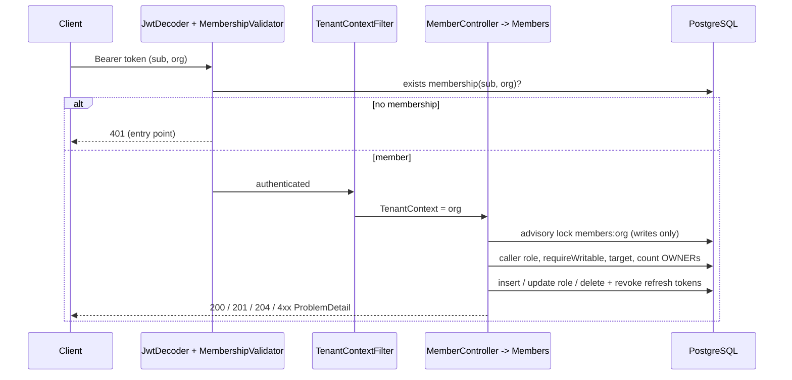

# Organization Members Design

**Spec**: `.specs/features/18-members/spec.md`
**Status**: Approved

---

## Architecture Overview

Everything stays in module `access` (AD-002), which already owns `memberships`, `users` and `refresh_tokens`. A new `MemberController` calls a new `Members` service. Two changes to auth make removal take effect at once. First, a JWT validator checks the membership on every request. Second, token issue locks the membership row so it can't race a removal.



---

## Code Reuse Analysis

### Existing Components to Leverage

| Component | Location | How to Use |
| --------- | -------- | ---------- |
| `MembershipRepository`, `Membership`, `Role` | `access/internal/` | add queries; add `changeRole` to the entity |
| `UserRepository.findByEmail` | `access/internal/UserRepository.java` | look up the user being added |
| `AuthService.normalizeEmail` | `access/internal/AuthService.java` | same e-mail rule as login, `InvalidEmailException` → `400` |
| `Organizations.requireWritable` | `access/Organizations.java` | archived organization → `409` |
| `NotAllowedException` | `access/NotAllowedException.java` | `403` |
| `RefreshTokens` advisory-lock pattern | `access/internal/RefreshTokens.java` | `pg_advisory_xact_lock(hashtextextended(?, 0))` per organization; add `revokeAll(userId, organizationId)` |
| `CompanyController` / `CompanyExceptionHandler` | `company/internal/` | controller and `ProblemDetail` mapping shape |
| `AuthFixture` | `test/.../access/AuthFixture.java` | register users, refresh, post JSON in ITs |

### Integration Points

| System | Integration Method |
| ------ | ------------------ |
| Security chain | `jwtDecoder` gets `DelegatingOAuth2TokenValidator(JwtValidators.createDefault(), membershipValidator)`; a failed validation becomes `InvalidBearerTokenException` → existing `401` entry point |
| Database | No migration: `memberships` already has `unique (user_id, organization_id)`, and `atlas_app` has `UPDATE`/`DELETE` through the V1 default privileges |

---

## Components

### MembershipValidator

- **Purpose**: refuses a token whose `(sub, org)` no longer has a membership (Remove AC 9).
- **Location**: `access/internal/MembershipValidator.java`
- **Interfaces**: `OAuth2TokenValidatorResult validate(Jwt jwt)`
- **Dependencies**: `JdbcClient`, which runs `select exists(select 1 from memberships where user_id = ? and organization_id = ?)` outside any transaction. `memberships` has no RLS, so it needs no tenant.
- **Reuses**: `SecurityConfiguration.jwtDecoder`

### Members (service)

- **Purpose**: list, add, change role, remove, with every rule from the spec.
- **Location**: `access/internal/Members.java`
- **Interfaces**:
  - `List<MemberView> list()`
  - `MemberView add(String email, String role)`
  - `MemberView changeRole(UUID userId, String role)`
  - `void remove(UUID userId)`
- **Order inside each write** (one `@Transactional`):
  1. advisory lock `members:<org>`;
  2. caller's membership: missing or `MEMBER` → `NotAllowedException`;
  3. `requireWritable(org)`;
  4. then the order from the spec's precedence row.
  The rules are judged after the lock, so a racing request sees the state the winner committed.
- **Last `OWNER`**: when the target is `OWNER` and the new role is not, `countByOrganizationIdAndRole(org, OWNER) == 1` → `LastOwnerException`.
- **Duplicate add**: `saveAndFlush`; a violation of `memberships_user_id_organization_id_key` → `AlreadyMemberException`. The constraint also settles the concurrent case.
- **Remove**: `delete` followed by `refreshTokens.revokeAll(userId, org)`.
- **Dependencies**: `MembershipRepository`, `UserRepository`, `Organizations`, `RefreshTokens`, `JdbcClient`

### MemberController + MemberExceptionHandler

- **Purpose**: HTTP mapping for `/api/members`.
- **Location**: `access/internal/MemberController.java`, `access/internal/MemberExceptionHandler.java`
- **Interfaces**: `GET /api/members`, `POST /api/members` (`{email, role}`), `PATCH /api/members/{userId}` (`{role}`), `DELETE /api/members/{userId}`
- **Notes**: request records hold plain `String`s with no `@Valid`, so the service decides `400` in spec order. A non-UUID path variable is `MethodArgumentTypeMismatchException` → `404`. An unparseable JSON body is `400` from the base class, before any role check.
- **Mapping**: `400` `InvalidEmailException`, `InvalidRoleException`; `403` `NotAllowedException`; `404` `MemberNotFoundException`, `UserNotFoundException`; `409` `AlreadyMemberException`, `LastOwnerException`, `OrganizationArchivedException`.

### Token issue lock

- **Purpose**: no refresh token outlives a removal that races it (Edge 2).
- **Location**: `access/internal/TokenIssuer.java` (`issue`), plus `MembershipRepository.lockForShare(userId, organizationId)` (`@Lock(PESSIMISTIC_READ)`).
- **How**: `issue` locks the membership row `FOR SHARE` and throws `NotAMemberException` when the row is gone. Removal's `DELETE` waits for that lock, and its `revokeAll` then sees the new token. When the removal goes first, `issue` finds no row. This covers register, login, refresh and switch, the four callers of `issue`.

---

## Data Models

```java
record MemberView(UUID userId, String name, String email, Role role) {}
```

The list is a JPQL theta join with no new entity relation: `select new MemberView(u.id, u.name, u.email, m.role) from Membership m, User u where u.id = m.userId and m.organizationId = :org order by u.name, u.email`.

`Membership` gains `void changeRole(Role role)`.

---

## Error Handling Strategy

| Error Scenario | Handling | User Impact |
| -------------- | -------- | ----------- |
| Token of a removed membership | validator failure → entry point | `401` ProblemDetail |
| Caller not allowed / hierarchy / self-removal | `NotAllowedException` | `403` |
| Unknown e-mail / target | `UserNotFoundException` / `MemberNotFoundException` | `404` |
| Bad e-mail / role | `InvalidEmailException` / `InvalidRoleException` | `400` |
| Duplicate / last `OWNER` / archived org | `AlreadyMemberException` / `LastOwnerException` / `OrganizationArchivedException` | `409` |
| Issue races a removal | refresh: its existing membership check switches to `lockForShare` → `InvalidRefreshTokenException`; login/switch: `NotAMemberException` from `issue` | refresh `401`; login/switch `403` (rare race) |

---

## Risks & Concerns

| Concern | Location (file:line) | Impact | Mitigation |
| ------- | -------------------- | ------ | ---------- |
| One extra query on every authenticated request | `SecurityConfiguration.jwtDecoder` | latency | indexed by the unique `(user_id, organization_id)`; accepted by the user ("Recusar na hora") |
| Refresh inserts a new token after removal's revoke statement started | `AuthService.refresh` / `RefreshTokens` | removed user keeps a live refresh token | `FOR SHARE` lock in `issue` (Token issue lock) |
| `Organizations.requireWritable` only takes `FOR SHARE`, which does not serialize two member writes | `access/Organizations.java` | two concurrent demotions could remove both `OWNER`s | advisory lock `members:<org>` taken first in each write |
| `register` always creates an organization, so an added user also owns one | `AuthService.register` | product wart | out of scope, listed in Deferred Ideas |

---

## Tech Decisions

| Decision | Choice | Rationale |
| -------- | ------ | --------- |
| Where the membership check runs | JWT validator in the decoder | fails before the tenant filter, through the existing `401` entry point; one place for every endpoint |
| Serializing member writes | transaction-scoped advisory lock per organization | same pattern as `RefreshTokens`; does not contend with company writes on the organization row |
| Identifier in the path | user id | memberships have their own id, but the API speaks of people; `(user, org)` is unique |
