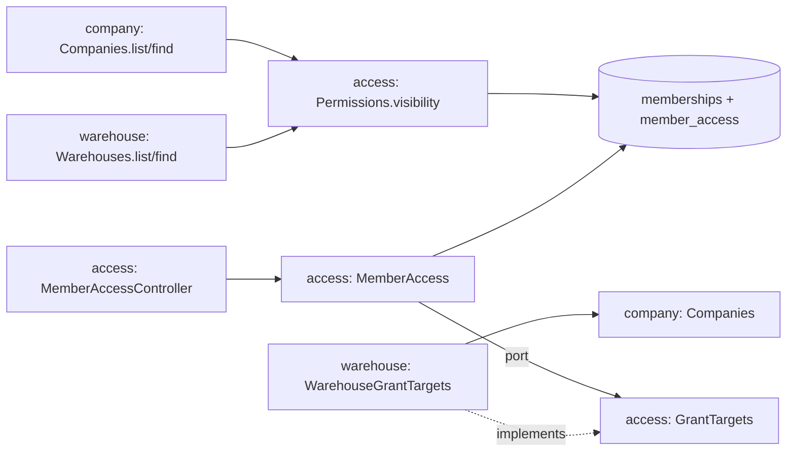

# Member Access by Company and Warehouse Design

**Spec**: `.specs/features/20-member-access/spec.md`
**Status**: Approved

---

## Architecture Overview

Grants live in module `access`, next to memberships. Visibility is decided in `access` and applied by `company` and `warehouse` in their read services, the layer the ITs reach. `access` cannot call `company` or `warehouse`, because both already depend on it. To check a grant target, `access` declares the port `GrantTargets`, and `warehouse` implements it. That keeps the dependency direction of ADR-001.



---

## Code Reuse Analysis

| Component | Location | How to Use |
| --------- | -------- | ---------- |
| `Members.lockAndRequireManager` and the member lock | `access/internal/Members.java` | grant and revoke take the same organization lock, then the caller check |
| `Permissions` | `access/Permissions.java` | gains `visibility()`, which reads role and grants from the database on every call |
| `MemberController` / `MemberExceptionHandler` | `access/internal/` | controller shape; ids as `String`, parsed after the caller and archive checks (F1 of feature 18) |
| Composite FK pattern | `V6__warehouses.sql` | tenant-bound FKs, because FK checks bypass RLS |
| `MemberApiIT`, `AuthFixture` | tests | add a member, switch organization, role changes |

---

## Data Model - `V7__member_access.sql`

```sql
alter table warehouses add constraint warehouses_tenant_company_id_key unique (tenant_id, company_id, id);

create table member_access (
    id           uuid primary key,
    tenant_id    uuid not null references organizations (id),
    user_id      uuid not null,
    company_id   uuid not null,
    warehouse_id uuid,            -- null: company grant
    created_at   timestamptz not null,
    constraint member_access_membership_fk foreign key (user_id, tenant_id)
        references memberships (user_id, organization_id) on delete cascade,
    constraint member_access_company_fk foreign key (tenant_id, company_id) references companies (tenant_id, id),
    constraint member_access_warehouse_fk foreign key (tenant_id, company_id, warehouse_id)
        references warehouses (tenant_id, company_id, id)
);
create unique index member_access_company_key on member_access (tenant_id, user_id, company_id) where warehouse_id is null;
create unique index member_access_warehouse_key on member_access (tenant_id, user_id, warehouse_id) where warehouse_id is not null;
-- forced RLS + tenant_isolation policy, same text as V6
```

- A warehouse grant stores its company, so visibility needs no join into `warehouses`.
- `on delete cascade` from `memberships` deletes the grants when a member is removed (Edge 1). A grant that races a removal either fails the FK or is deleted by the cascade (Edge 2). The grant also takes the member lock and checks the target under it.
- `(user_id, tenant_id)` matches the existing `unique (user_id, organization_id)` on `memberships`.

---

## Components

### Visibility (access, public)

- `record Visibility(boolean all, Set<UUID> companies, Set<UUID> warehouses, Set<UUID> warehouseCompanies)`
  - `seesCompany(c)`: `all || companies.contains(c) || warehouseCompanies.contains(c)`
  - `seesWarehouse(c, w)`: `all || companies.contains(c) || warehouses.contains(w)`
- `Permissions.visibility()`: role `OWNER`/`ADMIN` → `all`. A `MEMBER` gets their grants in the tenant context.

### GrantTargets (access, public port) + WarehouseGrantTargets (warehouse.internal)

- `boolean companyExists(UUID companyId)`
- `Optional<UUID> companyOfWarehouse(UUID warehouseId)`
- The warehouse implementation reads through `Companies` and its own repository, unfiltered: the caller is a manager by then.

### MemberAccess (access.internal) + MemberAccessController + exception handler

- `List<GrantView> list(String userId)`; `GrantView grant(String userId, UUID companyId, UUID warehouseId)`; `void revokeCompany(String userId, String companyId)`; `void revokeWarehouse(String userId, String warehouseId)`
- `record GrantView(GrantType type, UUID companyId, @Nullable UUID warehouseId)`
- Writes: member lock → caller is a manager, else `403` → `requireWritable` → target membership `404` → body `400` → target via `GrantTargets` `404` → insert; a unique violation gives `409`.
- Read: a manager reads anyone's; a `MEMBER` reads only their own (`403` otherwise); an unknown target gives `404`. The `MEMBER`-on-someone-else check runs before the target lookup, so no ids leak.
- Request body: plain `String` fields, parsed in the service so the precedence holds.

### Company and warehouse reads

- `Companies.list`: filter by `visibility.seesCompany`. `Companies.find`: an invisible company throws `CompanyNotFoundException` (`404`).
- `Warehouses.list` and `find`: they already call `companies.find(companyId)`, so an invisible company is `404`. Then filter or check with `seesWarehouse`.
- Writes keep `requireManager()` first. A manager sees everything, so writes are unchanged.
- Visibility is computed once per service call: one query for the role, one for the grants.

---

## Error Handling Strategy

| Error Scenario | Handling | User Impact |
| -------------- | -------- | ----------- |
| `MEMBER` grants or revokes / reads someone else | `NotAllowedException` | `403` |
| Unknown member, company, warehouse or grant | `*NotFoundException` | `404` |
| Bad body | `InvalidGrantException` | `400` |
| Duplicate | unique index violation → `DuplicateGrantException` | `409` |
| Archived organization | `OrganizationArchivedException` | `409` |
| Invisible company or warehouse for a `MEMBER` | existing `CompanyNotFoundException` / `WarehouseNotFoundException` | `404` |

---

## Risks & Concerns

| Concern | Location | Impact | Mitigation |
| ------- | -------- | ------ | ---------- |
| Every read gains 1-2 queries | `Permissions.visibility` | latency | indexed by the unique keys; accepted with "Recusar na hora" in feature 18 |
| Lists are filtered in Java after loading the whole organization | `Companies.list`, `Warehouses.list` | memory with many companies | `shortcut:` comment; move the filter to SQL with pagination |
| An FK cascade under forced RLS | `member_access_membership_fk` | cascade might not see rows | a schema IT proves the cascade deletes grants as `atlas_app` |
| `Warehouses` calls `Companies.find`, which is now filtered | `Warehouses.create/archive` | a manager-only path; `MEMBER` gets `403` before it | covered by existing write tests and the visibility tests |

---

## Tech Decisions

| Decision | Choice | Rationale |
| -------- | ------ | --------- |
| Cycle between `access` and `company`/`warehouse` | port `GrantTargets` in `access`, implemented in `warehouse` | respects ADR-001; the DB FKs still guard integrity |
| Grants removed with the membership | FK `on delete cascade` | one source of truth, settles the removal race |
| Where visibility applies | read services of `company` and `warehouse` | the layer the ITs reach; one rule for HTTP and future callers |
