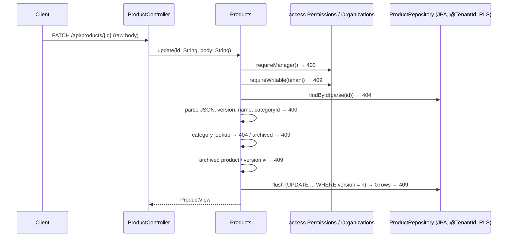

# Product Catalog Design

**Spec**: `.specs/features/22-product-catalog/spec.md`
**Status**: Approved (with the tasks)

---

## Architecture Overview

New module `catalog`, same layering as `warehouse`: public services (`Categories`, `Products`), views and exceptions in the module root; entities, repositories, controllers, exception handler and value parsing in `catalog.internal`. It depends on `access` only (`TenantContext`, `Permissions`, `Organizations`). No events: nothing else reacts to catalog changes yet.



Path ids and bodies reach the service as strings and are parsed after the role and organization checks, so the spec's precedence (`401 → 403 → 409 org → 404 path → 400 → 404 body category → 409`) holds for any input (lesson L-011). Spring's `UUID` path binding and `Pageable` resolver are not used: the first answers `404` before `403`, the second clamps an oversized `size` instead of answering `400`.

## Code Reuse Analysis

| Component | Location | How to Use |
| --------- | -------- | ---------- |
| Module layout, archive semantics, duplicate mapping from constraint names | `warehouse/Warehouses.java`, `warehouse/internal/*` | Same structure |
| Role and organization checks | `access.Permissions.requireManager()`, `access.Organizations.requireWritable()` | Called first in every write |
| Tenant binding | `@TenantId` + `TenantTransactionManager` (AD-001) | Entities carry `@TenantId tenantId`; never set by callers |
| Canonical UUID parsing | `access/internal/Uuids.java` | Package-private there: copy as `catalog/internal/CatalogIds` (8 lines) |
| Raw JSON body parsing | `access/internal/MemberAccess.readBody/text` | Same approach for `PATCH` and `POST` bodies (absent vs `null`) |
| Code parsing | `warehouse/internal/WarehouseCode` | Template for `Sku` |
| RLS policy, composite tenant FK | `V6__warehouses.sql` | Template for `V8__catalog.sql` |
| Test fixtures | `OwnerFixture`, `access/AuthFixture`, `access/AccessITSupport`, `warehouse/WarehouseApiIT`, `WarehouseSchemaIT`, `TenantIsolationIT` | Reuse for tokens, members, demotion and native SQL as `atlas_app` |

### Integration Points

| System | Integration Method |
| ------ | ------------------ |
| `access` | Public API only (checked by `ModularityTest`) |
| Database | `V8__catalog.sql`, owned by `atlas_owner`; `V1` default privileges already grant `atlas_app` |
| Security | `/api/categories/**`, `/api/products/**` fall under the existing "authenticated" rule; no config change |

## Components

### `Categories` (public service)

- **Location**: `catalog/Categories.java`
- **Interfaces**: `UUID create(String name)`, `List<CategoryView> list(boolean includeArchived)`, `CategoryView find(String id)`, `void archive(String id)`, `void unarchive(String id)`
- **Package-visible to `Products`**: `Category requireAssignable(String id)` - parses a body `categoryId`; `404` if not canonical or not found, `409` if archived.

### `Products` (public service)

- **Location**: `catalog/Products.java`
- **Interfaces**: `UUID create(String body)`, `ProductView find(String id)`, `ProductPage list(String page, String size, String q, String categoryId, String status)`, `ProductView update(String id, String body)`, `void archive(String id)`, `void unarchive(String id)`
- **Optimistic lock**: compares the body `version` with the entity's (`409` on mismatch), then `repository.flush()` inside the method so a concurrent winner surfaces as `ObjectOptimisticLockingFailureException` → `StaleProductVersionException` (`409`) inside the transaction, not at commit.

### Value types (`catalog/internal`)

- `Sku.parse(String)`: strip, upper-case (`Locale.ROOT`), `[A-Z0-9._-]{1,40}` or `InvalidSkuException`.
- `Unit` (public enum in `catalog`): `UN, CX, PC, KG, G, L, ML, M`, with `boolean fractional()`; `Unit.parse(String)` → `InvalidUnitException` for null or unknown.

### HTTP

- `CategoryController` (`/api/categories`), `ProductController` (`/api/products`) - thin: pass strings to the services, build `201` + `Location`.
- `CatalogExceptionHandler` (`@RestControllerAdvice(assignableTypes = {CategoryController, ProductController})`): `400` for invalid input exceptions, `403` `NotAllowedException`, `404` not-found exceptions, `409` duplicates, archived and stale version, `OrganizationArchivedException`. `ProblemDetail` throughout.

## Data Models

```sql
-- V8__catalog.sql
create table categories (
    id          uuid primary key,
    tenant_id   uuid not null references organizations (id),
    name        varchar(80) not null,
    archived_at timestamptz,
    constraint categories_tenant_id_key unique (tenant_id, id)
);
create unique index categories_tenant_name_key on categories (tenant_id, lower(name));

create table products (
    id          uuid primary key,
    tenant_id   uuid not null references organizations (id),
    sku         varchar(40) not null,
    name        varchar(200) not null,
    unit        varchar(2) not null check (unit in ('UN','CX','PC','KG','G','L','ML','M')),
    category_id uuid,
    archived_at timestamptz,
    version     bigint not null default 0,
    -- FK checks bypass RLS: the composite key keeps a product off another tenant's category; MATCH SIMPLE lets category_id be null
    constraint products_category_fk foreign key (tenant_id, category_id) references categories (tenant_id, id),
    constraint products_tenant_sku_key unique (tenant_id, sku)
);
create index products_tenant_name_idx on products (tenant_id, lower(name), id);
create index products_tenant_category_idx on products (tenant_id, category_id);
-- + enable/force RLS and the tenant_isolation policy on both tables, as in V6
```

Entities: `Category` (`id`, `@TenantId tenantId`, `name`, `archivedAt`), `Product` (`id`, `@TenantId tenantId`, `sku` and `unit` `updatable = false`, `name`, `categoryId`, `archivedAt`, `@Version long version`).

Views: `CategoryView(id, name, status)`, `ProductView(id, sku, name, unit, fractional, categoryId, status, version)`, `ProductPage(items, page, size, totalItems, totalPages)`.

List query (JPQL, `Page<Product>` with `PageRequest.of(page, size)`):

```
where (:status = 'ALL' or (:status = 'ACTIVE' and p.archivedAt is null) or (:status = 'ARCHIVED' and p.archivedAt is not null))
  and (:categoryId is null or p.categoryId = :categoryId)
  and (:q is null or lower(p.name) like :contains escape '\' or p.sku like :prefix escape '\')
order by lower(p.name), p.id
```

`contains` = `%` + escaped lower-cased `q` + `%`; `prefix` = escaped upper-cased `q` + `%`; escaping `\`, `%`, `_` (Edge 2). The builder may split this into a `Specification` if Hibernate cannot type the null parameters; behaviour is what the tests hold.

## Error Handling Strategy

| Error Scenario | Handling | User Impact |
| -------------- | -------- | ----------- |
| Duplicate SKU / category name | Catch `DataIntegrityViolationException` on `saveAndFlush`, match constraint name | `409` |
| Concurrent edit | Version compare + `flush()` + `ObjectOptimisticLockingFailureException` | `409`, row unchanged |
| Malformed JSON, wrong field type | Raw body parsed with Jackson `JsonNode` | `400` |
| Malformed path id | `CatalogIds.parse` → null → not found | `404` |

## Risks & Concerns

| Concern | Location | Impact | Mitigation |
| ------- | -------- | ------ | ---------- |
| Name search `like '%q%'` cannot use a btree index | list query | Seq scan per tenant at large catalogs | `shortcut:` comment; add `pg_trgm` GIN index when a tenant's catalog passes ~100k rows |
| Category archived between check and product insert | `Products.create/update` | Product lands in a just-archived category | Harmless (archived categories keep their products); `shortcut:` comment like `Warehouses.create` |
| `Permissions.requireManager` is not locked | `access/Permissions.java` | A demotion racing a write may let one write through | Same as features 14 and 16; role is re-read on every request (tested by demotion check) |
| Duplicated canonical-UUID helper | `access/internal/Uuids.java` | Two copies | 8 lines; extract to a shared public type only if a third module needs it |

## Tech Decisions

| Decision | Choice | Rationale |
| -------- | ------ | --------- |
| Path ids and bodies as strings parsed in the service | As feature 20 | Keeps precedence for malformed input (L-011) |
| Optimistic locking | JPA `@Version` + explicit compare | Explicit compare answers a stale client without touching the row; `@Version` catches the real race |
| No `Pageable` argument | Manual parse of `page`/`size` | Spec requires `400` for out-of-range values |
