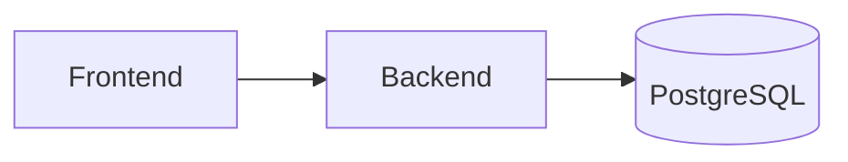

<!-- Modelo: renomeie para README.md e substitua os trechos entre <>. Apague seções que não se aplicam. -->

# <Nome do projeto>

[](https://github.com/<owner>/<repo>/actions/workflows/security.yml)
[](LICENSE)

<Uma frase: o que o produto faz e para quem.>

<!-- Captura de tela ou GIF do produto em uso. -->

## Por que este projeto

<O problema de engenharia que ele resolve e o que demonstra: 2–3 frases. Ex.: concorrência e integridade de estoque em ambiente multiempresa.>

## Funcionalidades

- <Funcionalidade principal>
- <Funcionalidade>

## Arquitetura

<Visão geral em um parágrafo: estilo arquitetural, módulos, como se comunicam.>



Decisões relevantes:

- [ADR-001: <título>](docs/adr/ADR-001-<titulo>.md)

## Stack

| Camada | Tecnologia |
|---|---|
| Backend | <linguagem + framework> |
| Frontend | Next.js, TypeScript, shadcn/ui |
| Banco de dados | PostgreSQL |
| Testes | <ferramentas> |
| Infraestrutura | Docker, GitHub Actions |

## Como rodar

Pré-requisitos: <Docker, versões de linguagem>.

```bash
git clone https://github.com/<owner>/<repo>.git
cd <repo>
git config core.hooksPath .githooks
<comando para subir o ambiente>
```

Acesse <http://localhost:3000>.

## Testes

```bash
<comando para testes unitários>
<comando para testes de integração>
```

## Documentação

- [Convenções](docs/CONVENCOES.md)
- [Decisões](docs/DECISOES.md)
- [ADRs](docs/adr/)
- [Changelog](CHANGELOG.md)

## Licença

[MIT](LICENSE)
